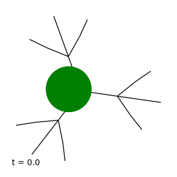

Introduction
============

QSW_MPI uses sparse Fortran operators and MPI to simulate Markovian open
quantum systems. For continuous-time quantum stochastic walks on directed
or undirected graphs, use :class:`~qsw_mpi.MPI.LQSW` for local Lindblad
operators or :class:`~qsw_mpi.MPI.GQSW` for global Lindblad operators.
For other open systems, :class:`~qsw_mpi.MPI.GKSL` accepts a sparse
Hamiltonian and a sequence of Lindblad operators directly.

